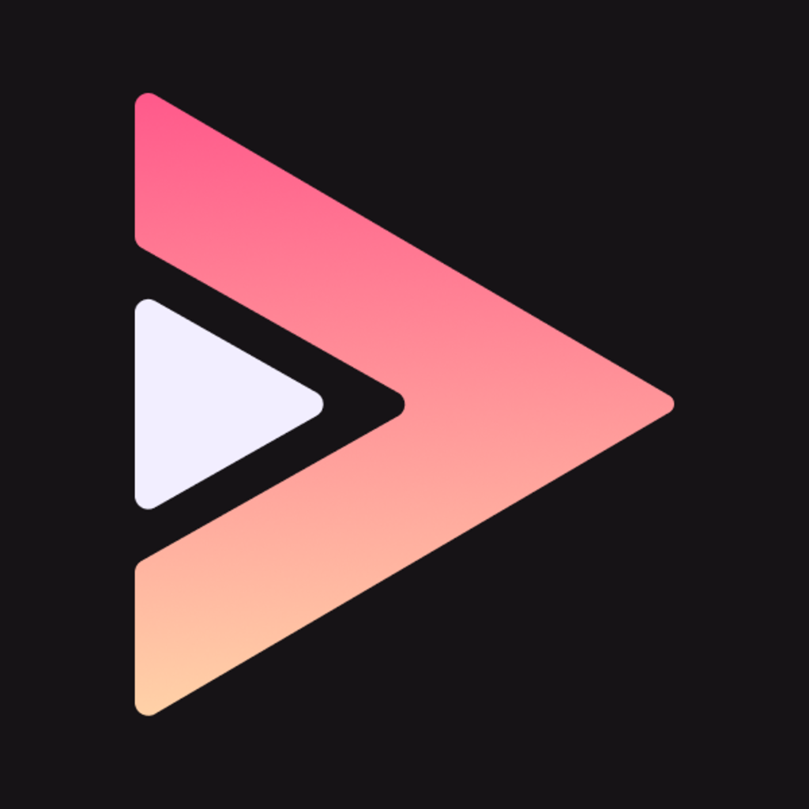
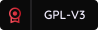

<div align="center">
  

# Mobius

A private YouTube client for iPhone and iPad, without Google accounts, ads or tracking. A native SwiftUI app based on [LibreTube](https://github.com/libre-tube/LibreTube).

[](https://www.gnu.org/licenses/gpl-3.0.en.html)

</div>

## Features

**Watching**
- Native player (AVKit) with Picture-in-Picture, AirPlay, lock screen / Control Center controls and background playback, including with the screen locked
- Mini player that stays above the tab bar; drag the player down to minimize it, swipe up on the video for full screen
- **Queue**: touch and hold any video to add it to the queue (or to its top with "Play Next"); queued videos play before autoplay. Swipe right in the queue to remove a video, touch and hold to reorder
- Full screen always turns to landscape on iPhone, even with the rotation lock on
- Quality menu (Auto or a fixed resolution), with a preferred quality in Settings
- **Audio only**: streams only the audio (no video data is downloaded) and shows the cover art instead – ideal for music
- **Autoplay**: plays the next related video when one ends, also in the background; the "next" button on the lock screen and headphones skips to it
- SponsorBlock: skips sponsors, intros and other segments you choose
- [DeArrow](https://dearrow.ajay.app) (optional): replaces clickbait titles and thumbnails with community-submitted ones; lookups send only a hash prefix of the video ID
- [Return YouTube Dislike](https://returnyoutubedislike.com) (optional): shows estimated dislike counts in the player
- Chapters, description, related videos and comments

**Music**
- Artist pages for "Artist - Topic" channels, from YouTube Music: top songs, albums, singles & EPs, videos, playlists, "featured on" and similar artists
- Albums and YouTube Music playlists open like any other playlist

**Browsing**
- Home with Featured (latest from your subscriptions), Continue Watching, Live Now and your playlists – each section can be turned on or off in Settings
- Subscriptions feed and channel list
- Channels with their videos and playlists
- Search with filters (videos, channels, playlists), suggestions and recent searches
- Hide Shorts everywhere or on chosen screens, optionally any video under a length you pick

**Your library – stored only on your device**
- Subscriptions without an account
- Watch history with resume positions (swipe to remove an entry)
- Local playlists; any YouTube playlist can be saved as a local copy
- Import from NewPipe, LibreTube / Piped backups, FreeTube, YouTube Takeout or a plain list of links

## How it works

By default the app talks to YouTube directly from your device ("on-device" video source):

- **Playback** uses YouTube's own streaming protocol (SABR). A small server inside the app turns it into HLS for the system player, so playback works like in Safari, with adaptive quality and no time limits.
- **Channels, playlists, comments and related videos** come from YouTube's InnerTube API; artist pages come from YouTube Music.
- **The subscription feed** combines YouTube's per-channel feeds with a [Piped](https://github.com/TeamPiped/Piped) instance, so it stays up to date even for channels the instance doesn't follow.

Alternatively you can switch the video source to a **Piped instance** in Settings, so YouTube never sees your IP address for playback. Search, suggestions and Live Now always go through the selected Piped instance.

No Google account is used and nothing is sent to the developer.

## Install

The app isn't on the App Store. Build an `.ipa` (see below) or use one you trust, and sideload it with a tool such as [SideStore](https://sidestore.io), [AltStore](https://altstore.io) or [LiveContainer](https://github.com/LiveContainer/LiveContainer).

Requires iOS 17 or later. The Liquid Glass design needs iOS 26; earlier versions get the classic look.

> Using LiveContainer? If choosing a file to import does nothing, enable "Fix File Picker" in Mobius's settings inside LiveContainer.

## Build

The app is a Swift package (Swift 6, no third-party dependencies) and can be built on Linux or macOS with [xtool](https://github.com/xtool-org/xtool):

```sh
# once: install xtool and the iOS SDK (needs an Xcode .xip from Apple)
xtool setup

xtool dev build --ipa    # writes xtool/Mobius.ipa
```

Project layout:

| Path | What's inside |
| --- | --- |
| `Sources/MobiusCore` | Models, Piped and YouTube (InnerTube, YouTube Music, SABR) clients, local library, importers, settings – Foundation only |
| `Sources/Mobius` | The SwiftUI app: screens, player, local HLS server, BotGuard and player-script helpers |
| `CONTRACT.md`, `CONTRACT-SABR.md` | Design notes for the modules |

## Troubleshooting

Settings › About › **Playback Log** shows what the player is doing (stream type, quality, network errors). Please include it when reporting a playback problem.

## Credits

Based on [LibreTube](https://github.com/libre-tube/LibreTube) and its contributors, whose Android app Mobius follows in features, data formats and its SABR client. Also thanks to [Piped](https://github.com/TeamPiped/Piped), [SponsorBlock](https://sponsor.ajay.app) and DeArrow, [Return YouTube Dislike](https://returnyoutubedislike.com), [yt-dlp](https://github.com/yt-dlp/yt-dlp) and [LuanRT/googlevideo](https://github.com/LuanRT/googlevideo) for documenting how YouTube streaming works.

## Privacy Policy and Disclaimer

Everything the app stores – subscriptions, history, playlists and settings – stays on your device. Nothing is collected by the app or its developer; see the privacy policy of the Piped instance you choose in the app.

This project is not affiliated with YouTube or Google.

## License
[](http://www.gnu.org/licenses/gpl-3.0.en.html)

Mobius, like LibreTube, is [Free Software](https://en.wikipedia.org/wiki/Free_software): You can use, study, share and modify it at your will. The app can be redistributed and/or modified under the terms of the
[GNU General Public License version 3 or later](https://www.gnu.org/licenses/gpl.html) published by the
[Free Software Foundation](https://www.fsf.org/).
